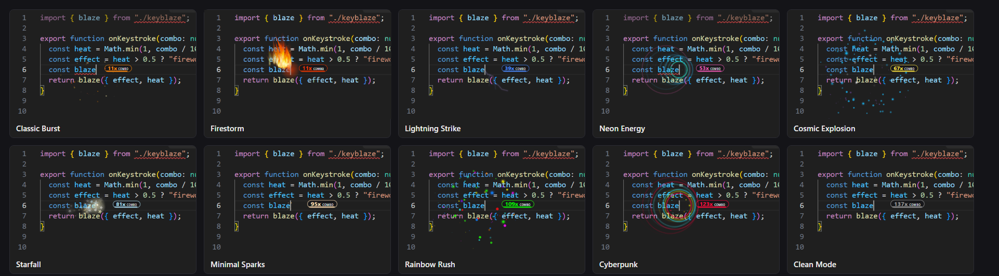
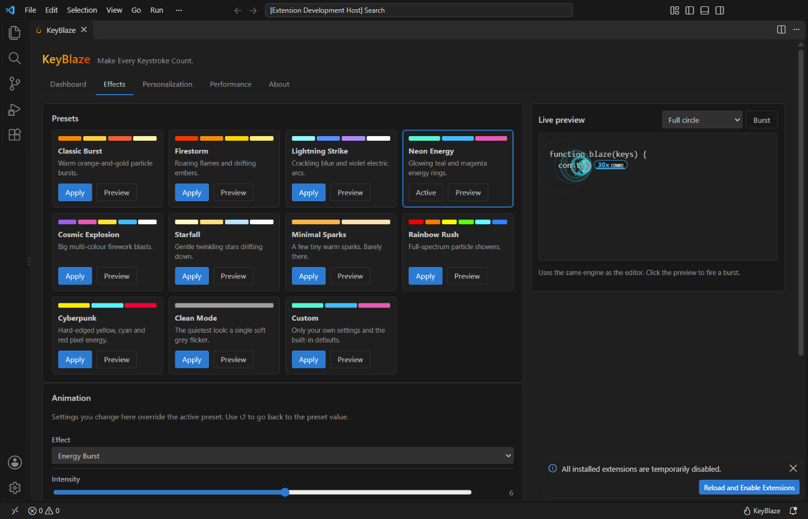
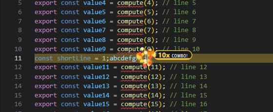

<h1 align="center">
  <picture>
    <source media="(prefers-color-scheme: light)" srcset="https://github.com/acarlewis/KeyBlaze/raw/HEAD/media/logo/Light_Background_application.png">
    
  </picture>
</h1>

<strong>Make Every Keystroke Count.</strong>

KeyBlaze brings your editor to life with particle bursts, fire, lightning, energy rings, fireworks
and stars that erupt from your cursor as you type. It adds combo streaks, milestone celebrations,
cursor effects and optional synthesised sounds. It's a modern take on the idea behind the
discontinued Power Mode extension, rebuilt from scratch on **supported VS Code APIs only**. There are
no patched workbench files, no injected CSS and no "corrupt installation" warnings.

> **Preview release.** Tested on Windows 11 with VS Code 1.90 and 1.147. macOS and Linux haven't been
> verified yet; see [Known limitations](#known-limitations).

## Features

- **Seven effects:** Particle Explosion, Fire, Lightning, Energy Burst, Fireworks, Stars and Minimal.
  Each one is procedurally generated, so no two keystrokes look the same.
- **Ten presets:** Classic Burst, Firestorm, Lightning Strike, Neon Energy, Cosmic Explosion,
  Starfall, Minimal Sparks, Rainbow Rush, Cyberpunk and Clean Mode. You can tweak anything on top of a
  preset, or build your own look.
- **Combos:** a small animated badge next to your code counts your streak and shows the time left
  before it resets. Milestones (10, 25, 50, 100 and so on) trigger a celebration.
- **Impact Pulse:** an optional milestone "shake" of the effect and badge, plus a brief line flash.
  The editor text never moves.
- **Cursor effects:** a glow or energy ring that follows the cursor, or sparks and a trail when you
  move around.
- **Control Panel:** a themed settings UI with a live preview that uses the same engine as the editor.
- **Sound (optional, off by default):** four original, synthesised sound themes, played on milestones
  or as subtle per-keystroke ticks.
- **Respectful by default:** follows reduced motion, pauses for screen readers and while VS Code is
  unfocused, and has a performance mode for slower machines.
- **Precise:** effects are centred on the cursor to within half a pixel, measured in a real VS Code.
  This holds in split editors, after scrolling, and at different font sizes and zoom levels.

## Getting started

1. Install KeyBlaze from the Visual Studio Code Marketplace, or from a `.vsix` file
   (**Extensions → … → Install from VSIX…**).
2. Start typing. Effects are on by default with the **Classic Burst** preset.
3. Run **KeyBlaze: Open Control Panel** from the Command Palette (`Ctrl+Shift+P` / `Cmd+Shift+P`)
   to pick a preset and customise it.

Click the **🔥 KeyBlaze** item in the status bar to turn effects on or off at any time.

## Presets

| Preset           | Effect             | Look                                           |
| ---------------- | ------------------ | ---------------------------------------------- |
| Classic Burst    | Particle Explosion | Warm orange-and-gold particle bursts (default) |
| Firestorm        | Fire               | Roaring flames and drifting embers             |
| Lightning Strike | Lightning          | Crackling blue and violet electric arcs        |
| Neon Energy      | Energy Burst       | Glowing teal and magenta energy rings          |
| Cosmic Explosion | Fireworks          | Big multi-colour firework blasts               |
| Starfall         | Stars              | Gentle twinkling stars drifting down           |
| Minimal Sparks   | Minimal            | A few tiny warm sparks                         |
| Rainbow Rush     | Particle Explosion | Full-spectrum particle showers                 |
| Cyberpunk        | Energy Burst       | Hard-edged yellow, cyan and red pixel energy   |
| Clean Mode       | Minimal            | The quietest look: a single soft grey flicker  |

A preset supplies the effect, colours, shape and particle values. Any of those settings that you
change yourself override the preset. In the Control Panel these show a **•** marker and a **↺** button
to go back to the preset value. Choose **Custom** to use only your own settings.

## Combos and milestones

Every genuine keystroke adds to the combo, and a pause longer than `keyblaze.combo.resetTime` ends
it. The badge appears after the end of the current line, next to the code and never over it. At each
milestone, KeyBlaze fires a bigger burst and, if enabled, an Impact Pulse and a milestone sound. Your
best combo is remembered between sessions.

## Commands

| Command                                 | What it does                                             |
| --------------------------------------- | -------------------------------------------------------- |
| KeyBlaze: Enable / Disable / Toggle     | Turn effects on or off (also: click the status bar item) |
| KeyBlaze: Open Control Panel            | Open the settings UI with a live preview                 |
| KeyBlaze: Change Effect                 | Pick a preset or a base effect                           |
| KeyBlaze: Next Effect / Previous Effect | Cycle through the base effects                           |
| KeyBlaze: Apply Preset                  | Pick a preset                                            |
| KeyBlaze: Preview Effect                | Fire a few bursts at the cursor                          |
| KeyBlaze: Open Sound View               | Turn on sound and open the KeyBlaze Sound view           |
| KeyBlaze: Reset Settings                | Reset all KeyBlaze settings (asks for confirmation)      |

## Settings

Everything can be set in the Control Panel, or in **Settings** (search for `keyblaze`).

| Setting                                                       | Default                       | Description                                                                              |
| ------------------------------------------------------------- | ----------------------------- | ---------------------------------------------------------------------------------------- |
| `keyblaze.enabled`                                            | `true`                        | Turn effects on or off                                                                   |
| `keyblaze.preset`                                             | `classicBurst`                | Active preset (`custom` = only your own settings)                                        |
| `keyblaze.effect`                                             | `particles`                   | Base effect: `particles`, `fire`, `lightning`, `energy`, `fireworks`, `stars`, `minimal` |
| `keyblaze.intensity`                                          | `5`                           | Overall energy, 1–10                                                                     |
| `keyblaze.particleCount`                                      | `14`                          | Particles per keystroke, 1–40                                                            |
| `keyblaze.particleSize`                                       | `3`                           | Particle size in px, 1–12                                                                |
| `keyblaze.particleSpeed`                                      | `1`                           | Speed multiplier, 0.25–3                                                                 |
| `keyblaze.particleLifetime`                                   | `650`                         | Burst duration in ms, 150–2000                                                           |
| `keyblaze.particleShape`                                      | `auto`                        | `auto`, `circle`, `square`, `triangle`, `star`, `spark`                                  |
| `keyblaze.colors`                                             | warm palette                  | Up to 12 hex colours                                                                     |
| `keyblaze.placement`                                          | `auto`                        | `auto` (full-circle where possible) or `cursorLine` (always rise from the cursor line)   |
| `keyblaze.triggerOnDelete`                                    | `true`                        | Effects for Backspace and Delete too                                                     |
| `keyblaze.cursor.effect`                                      | `none`                        | `none`, `glow`, `sparks`, `ring`, `trail`                                                |
| `keyblaze.combo.enabled`                                      | `true`                        | Track combos                                                                             |
| `keyblaze.combo.resetTime`                                    | `3000`                        | ms of inactivity before the combo resets                                                 |
| `keyblaze.combo.showIndicator`                                | `true`                        | Show the combo badge                                                                     |
| `keyblaze.combo.showInStatusBar`                              | `true`                        | Show the combo in the status bar                                                         |
| `keyblaze.combo.milestones`                                   | `[10, 25, 50, 100]`           | Milestone counts                                                                         |
| `keyblaze.screenShake.enabled`                                | `false`                       | Impact Pulse on milestones                                                               |
| `keyblaze.screenShake.intensity` / `.duration` / `.flashLine` | `3` / `250` / `true`          | Impact Pulse strength, length and line flash                                             |
| `keyblaze.sound.enabled`                                      | `false`                       | Synthesised sounds                                                                       |
| `keyblaze.sound.volume` / `.theme` / `.mode`                  | `0.3` / `soft` / `milestones` | Volume, theme (`soft`, `mechanical`, `arcade`, `chime`) and when to play                 |
| `keyblaze.performanceMode`                                    | `false`                       | Fewer particles, no glow, simpler animation                                              |
| `keyblaze.performance.quality`                                | `high`                        | `low`, `medium`, `high`                                                                  |
| `keyblaze.performance.maxBurstsPerSecond`                     | `12`                          | Bursts started per second (evenly paced)                                                 |
| `keyblaze.performance.maxConcurrentBursts`                    | `8`                           | Bursts on screen at once                                                                 |
| `keyblaze.performance.frameRateLimit`                         | `60`                          | Control Panel preview frame-rate cap                                                     |
| `keyblaze.accessibility.respectReducedMotion`                 | `true`                        | Calm effects when reduced motion is requested                                            |
| `keyblaze.accessibility.disableWithScreenReader`              | `true`                        | Pause while screen-reader optimisation is on                                             |
| `keyblaze.excludeLanguages`                                   | `[]`                          | Language IDs without effects, for example `["markdown"]`                                 |
| `keyblaze.excludeFiles`                                       | `[]`                          | Glob patterns without effects, for example `["**/*.min.js"]`                             |

## Sound

Sound is off by default. Run **KeyBlaze: Open Sound View**, then click **Enable sound** once. Browsers
(and therefore VS Code webviews) only allow audio after a click. After that the view can be
collapsed and sounds keep playing for the rest of the session. All sounds are generated in code; no
recorded audio is used. Sounds pause while a screen reader is in use, while VS Code is unfocused, and
when KeyBlaze is disabled.

## Accessibility

- **Reduced motion:** with `workbench.reduceMotion` set to `on`, or `auto` while your OS asks for
  reduced motion, every effect becomes a few tiny, calm sparks. There is no Impact Pulse, no pulsing
  and no badge pop. The extension host can't read the OS preference directly, so `auto` takes effect
  once the Control Panel or Sound view has been opened (the preference is then remembered).
- **Screen readers:** with `editor.accessibilitySupport` set to `on`, KeyBlaze pauses effects, combos
  and sounds. VS Code's automatic screen-reader detection (`auto`) isn't visible to extensions, so set
  it to `on` explicitly if you use a screen reader.
- Effect images are decorative and don't add text to the editor.

## Performance

KeyBlaze measures what it costs, so you don't have to guess. In a real VS Code, typing latency is
unaffected with every preset at 12 and 25 keystrokes per second; full numbers are in
[docs/PERFORMANCE.md](docs/PERFORMANCE.md).

On slower machines or high-refresh displays:

1. Turn on **Performance mode** (`keyblaze.performanceMode`).
2. Lower **Animation quality** to `medium` or `low`.
3. Lower **Max bursts per second** (for example to `8`).
4. Prefer lighter presets (Minimal Sparks, Clean Mode) over Cosmic Explosion or Firestorm.
5. Exclude huge generated files with `keyblaze.excludeFiles`.

KeyBlaze does no work at all while it is disabled, paused for a screen reader, or while VS Code is
unfocused. Effects cost CPU only while you type: bursts end within a second, and a cursor glow or ring
stops pulsing 5 seconds after you stop.

## How it works

VS Code doesn't let extensions draw over the editor. KeyBlaze therefore renders every burst as a small,
unique animated SVG attached to the text with the official **decorations** API. The decoration is
sized and offset so that it never shifts your code and its centre lands exactly on the cursor. Full-circle
effects are attached a few lines below the cursor. Next to wide characters, inlay hints, folds, word
wrap or the end of the file, KeyBlaze switches to rising effects on the cursor line. The Control
Panel and the Sound view are webviews. The design, and the measurements behind it, are documented in
[docs/ARCHITECTURE.md](docs/ARCHITECTURE.md) and [docs/SPIKE_REPORT.md](docs/SPIKE_REPORT.md).

## Troubleshooting

| Problem                                             | Try                                                                                                                                                                                                                                                  |
| --------------------------------------------------- | ---------------------------------------------------------------------------------------------------------------------------------------------------------------------------------------------------------------------------------------------------- |
| No effects at all                                   | Check the status bar: **⊘ KeyBlaze** means disabled, **⏸ KeyBlaze** means paused for a screen reader. Check `keyblaze.excludeLanguages` / `excludeFiles`. Effects only appear for typing in text editors, not for paste, undo or programmatic edits. |
| Effects look slightly too low or high               | You may be using editor font zoom (which extensions can't detect) or a proportional font. Set `keyblaze.placement` to `cursorLine`.                                                                                                                  |
| Effects are always "rising" instead of full circles | Expected next to wide characters, inlay hints, folds, with word wrap on, or near the end of the file.                                                                                                                                                |
| Typing feels heavy                                  | Follow the [Performance](#performance) steps, starting with performance mode.                                                                                                                                                                        |
| No sound                                            | Sound is off by default. Run **KeyBlaze: Open Sound View** and click **Enable sound** once per session. It's muted while VS Code is unfocused or a screen reader is in use.                                                                          |
| Combo badge not visible                             | It sits after the end of the line, so on very long lines it may be scrolled out of view. The status bar also shows the combo.                                                                                                                        |
| Something else                                      | Open **Output → KeyBlaze** for diagnostics and include them in a bug report.                                                                                                                                                                         |

## Known limitations

- **Platforms:** tested on Windows 11 only (VS Code 1.90.0 and 1.147.0). macOS, Linux, remote
  development (WSL, SSH, containers, Codespaces) and VS Code Insiders haven't been verified yet.
  VS Code for the Web isn't supported.
- **No real screen shake:** moving the editor text isn't possible with supported APIs. Impact Pulse
  shakes the effect layer instead.
- **Full-circle effects need room below the cursor:** next to wide characters, inlay hints, folds,
  wrapped lines or the end of the file, effects rise from the cursor line instead.
- **Editor font zoom and proportional fonts** can offset full-circle effects slightly. Use
  `keyblaze.placement: cursorLine`.
- **The combo badge sits after the end of the line** and can be out of view on very long lines.
- **Sound needs one click per session** in the KeyBlaze Sound view (browser autoplay rules).
- **Accessibility detection:** `editor.accessibilitySupport: auto` and the OS reduced-motion preference
  aren't directly visible to extensions (see [Accessibility](#accessibility)).

## Contributing

Contributions are welcome. See [CONTRIBUTING.md](CONTRIBUTING.md) for the project layout, the
development workflow and the test suites (unit, integration on two VS Code versions, and visual
checks in a real VS Code).

## License

[MIT](LICENSE)
