

  <picture>
    <source media="(prefers-color-scheme: light)" srcset="../media/logo/Light_Background_application.png">
    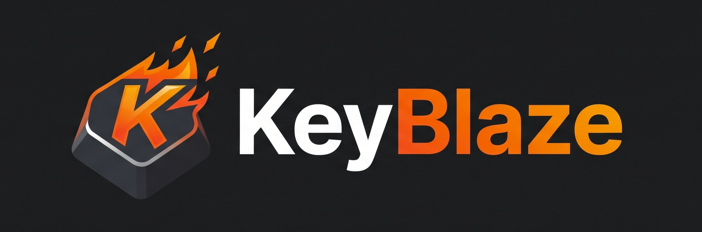
  </picture>

# KeyBlaze rendering spike: results

**Date:** 2026-11-19 · **VS Code:** 1.147.0 (Electron/Chromium), Windows 11, 144 Hz display, 1400×900 viewport at DPR 1
**Status:** Complete. Phase 4 is on hold until this report has been reviewed.

## 1. Method

All results come from a real VS Code instance driven by a script.

- **Proof of concept:** [`spike/poc/extension.js`](../spike/poc/extension.js) is a separate throwaway extension that uses **only official VS Code APIs**: decorations, selections, visible ranges, webviews and configuration. It renders real KeyBlaze engine bursts by loading the compiled engine read-only. **No KeyBlaze source file was modified.**
- **Test harness:** [`spike/lib.mjs`](../spike/lib.mjs) launches an isolated VS Code with the Chrome DevTools Protocol (CDP) enabled. CDP is used purely as **test tooling** to:
  - send real keystrokes through VS Code's normal keyboard path;
  - measure the pixel boxes of the caret and of each effect image (the `::after` element);
  - read renderer performance metrics;
  - read screenshot pixels, to measure animation progress objectively;
  - take screenshots.
- **Raw data:** every number below is in [`docs/spike/data/`](spike/data/).

## 2. Answers to the seven questions

### Q1. Can we reliably detect the cursor position with the official API?

**Yes for the logical position. No pixel coordinates are available.**

| Measurement (10 real keystrokes, then arrow keys)         | Result                                                      |
| --------------------------------------------------------- | ----------------------------------------------------------- |
| `onDidChangeTextDocument` fired for each keystroke        | 10 out of 10                                                |
| Time from keystroke to change event in the extension host | median **7 ms** (one 158 ms outlier on the first keystroke) |
| `onDidChangeTextEditorSelection`                          | fired for every caret move, `kind = Keyboard`               |
| `selection.active` / `visibleRanges`                      | always matched the real caret                               |

The API reports the line and character. There's no API for the caret's pixel position, the font metrics, or the editor's on-screen geometry.

### Q2. Can effects be drawn precisely around the cursor?

**Yes, using decorations with zero layout impact.** Measured error across all cases:

| Case                                              | Caret-anchored dx / dy (px) | Below-anchored dx / dy (px) |
| ------------------------------------------------- | --------------------------- | --------------------------- |
| Middle of line, end of line, column 0, empty line | ≤ 0.3 / 0.1                 | ≤ 0.25 / 0.1                |
| After two tabs                                    | −0.4 / 0.1                  | −0.43 / 0.1                 |
| After CJK text                                    | 0.19 / 0.1                  | **−12.4** / 0.1 ❌          |
| After emoji                                       | −0.36 / 0.1                 | **−8.0** / 0.1 ❌           |
| Second visual row of a word-wrapped line          | −0.08 / 0.1                 | −0.41 / **19.1** ❌         |
| Text shift of the decorated line                  | **0** in every case         | **0** in every case         |

#### How VS Code positions decoration images

These findings come from measuring the layout directly.

- **Rendering:** `contentIconPath` becomes `::after { content: url(…) }`, an inline-block containing a replaced image.
- **Bottom edge:** the image's bottom is pinned to the anchor line's text baseline. Margins never move it vertically.
- **Top margin:** a top margin of `−height` gives the image zero layout height, so it never moves text. A less negative top margin enlarges the line box and pushes the line's own text down.
- **Bottom margin:** has no effect.
- **Horizontal:** margin-left and margin-right of `−width/2` centre the image on the caret with zero net width. That's sub-pixel exact.
- **`calc()` and `em`:** both are accepted in `margin`.

> ⚠️ **Critical bug found in the current KeyBlaze implementation (Phase 2).** `attachmentMargin()` in `src/render/geometry.ts` uses a top margin of 0, which **pushes the typed line's text down by ~50 px** while a burst is visible (screenshot below). The integration tests could not catch this because they don't inspect pixels. The fix is the zero-height margin described above. It should be the first change in Phase 4 (it was not modified, as instructed).

| Phase 2 formula: the line's text is pushed down        | Zero-height margin: the text is untouched            |
| ------------------------------------------------------ | ---------------------------------------------------- |
| 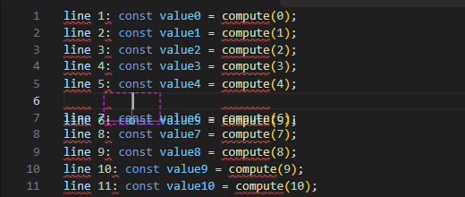 | 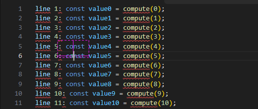 |

#### Two anchoring strategies, both using supported APIs only

- **Caret-anchored:** the decoration sits on the caret line.
  - **Strengths:** pixel-exact in every case we tested. VS Code itself handles tabs, CJK, emoji, word wrap, folding and inlay hints.
  - **Limit:** the image can only extend **upward** from the baseline, about 4 px below the line's middle.
- **Below-anchored:** the decoration sits at column 0 of a line _N_ below the caret.
  - **Horizontal:** offset by the caret's visual column, in `ch` units.
  - **Vertical:** the SVG is padded so that its centre lands on the caret line. This gives **full-circle** effects.
  - **Limits:** it assumes a monospace column width (wrong after CJK or emoji) and an unwrapped line height (wrong when wrapping falls in between).

| Below-anchored: full-circle burst, real keystroke, real engine (40 / 140 / 300 / 520 ms)                                                       |
| ---------------------------------------------------------------------------------------------------------------------------------------------- |
| 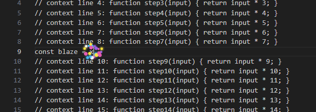 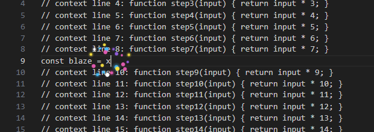 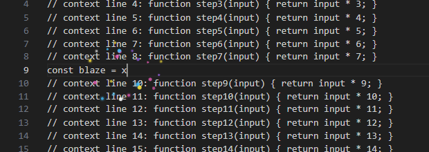 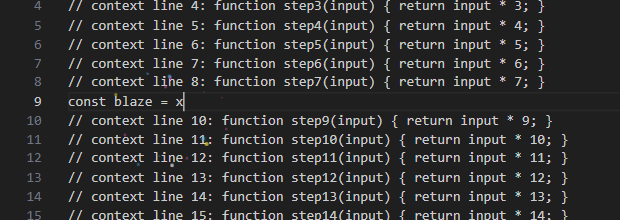 |

| Caret-anchored with the same full-circle burst: the lower half is cut off and particles vanish as they fall (40 / 140 ms) |
| ------------------------------------------------------------------------------------------------------------------------- |
| 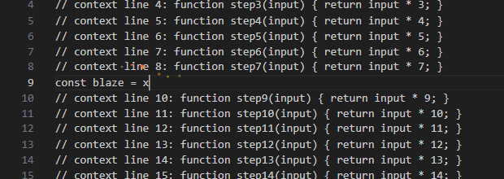 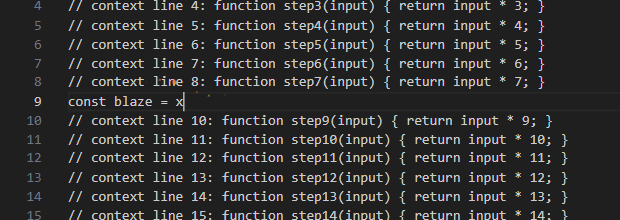                                                    |

### Q3. Can a Webview-based renderer follow the cursor?

**No.** We tested this, and confirmed it in the API surface:

- A `WebviewPanel` can only be placed by `ViewColumn`, so it becomes its own editor tab or group (screenshot). A `WebviewView` lives in the sidebar or the panel.
- No API places a webview over a text editor, makes one transparent above it, or gives caret pixel coordinates to map into one.
- Messaging is fast: extension → webview → extension round trip is a median of **1 ms**, p95 3 ms. That makes webviews a good fit for the **Control Panel preview** and **sound playback**, but not for drawing effects over the editor.

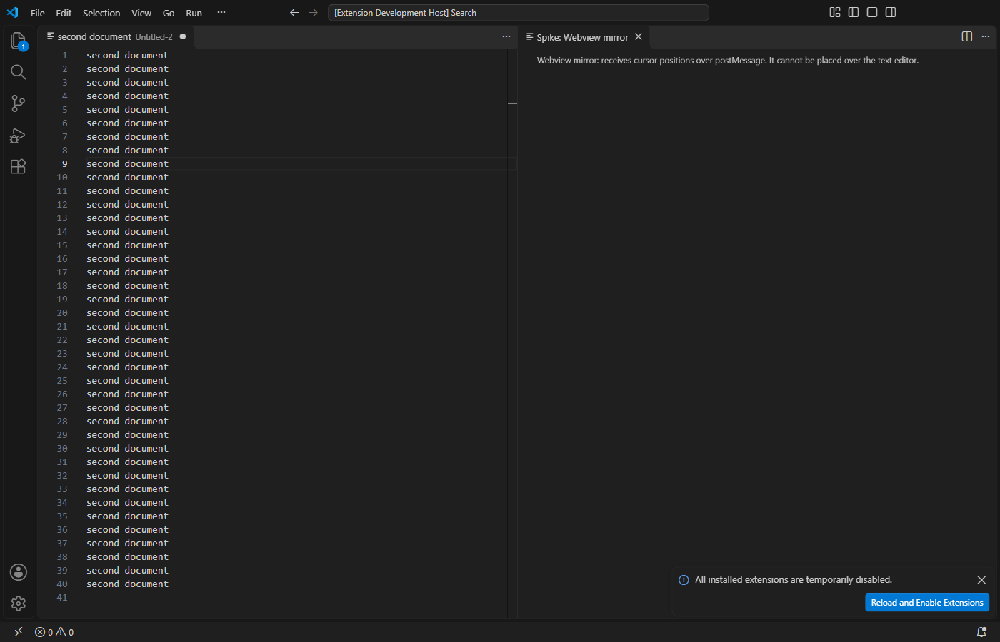

### Q4. Decorations, Webviews, or something else?

| Approach                                                                    | Verdict                                                                                                                                                                                      |
| --------------------------------------------------------------------------- | -------------------------------------------------------------------------------------------------------------------------------------------------------------------------------------------- |
| **Decorations + generated animated SVG**                                    | ✅ **Use this.** Exact positioning, follows typing (the new burst appears in the DOM about 26 ms after the keystroke, including probe overhead), no text shift, works in every editor group. |
| Webview overlay                                                             | ❌ Not possible with the API.                                                                                                                                                                |
| Raw CSS injection through the `textDecoration` string (Power Mode's method) | ❌ Undocumented, and against the project rules. Not needed.                                                                                                                                  |
| Custom editor or notebook renderer                                          | ❌ It would replace the user's editor.                                                                                                                                                       |
| Patching workbench files or DOM                                             | ❌ Unsupported, fragile, and triggers VS Code's "installation is corrupt" warning.                                                                                                           |

### Q5. Split editors, scrolling, multiple groups and zoom levels

| Scenario                                                   | Result                                                                                                                                                                                        |
| ---------------------------------------------------------- | --------------------------------------------------------------------------------------------------------------------------------------------------------------------------------------------- |
| 3 editor groups, including the same document in two groups | Effects render in the correct editor. All 3 carets found. dx ≤ 0.5 px, dy 0.1 px.                                                                                                             |
| Scroll 3 lines while an effect is visible                  | The effect stays locked to its line (dx −0.01, dy 0.1).                                                                                                                                       |
| Anchor line scrolled out of view, then back                | Removed while off-screen (VS Code virtualises lines). Back in place on return, **and the animation continues without restarting** (bar at 0.62 vs 0.67 expected; a restart would read ≈0.27). |
| `window.zoomLevel` +1 / −1                                 | dx ≤ 0.03, dy ≤ 0.5 px                                                                                                                                                                        |
| `editor.fontSize` 20, `editor.lineHeight` 30               | dx ≤ 0.05, dy ≤ 0.5 px (both anchors)                                                                                                                                                         |
| Editor font zoom (`editor.action.fontZoomIn` ×2)           | Caret-anchored: dy 1 px ✅. Below-anchored: **dy 10.7 px** ❌. Font zoom changes the rendered line height but not the `editor.fontSize` setting, and no API exposes it.                       |
| Typing on the anchor line while it animates                | **The animation does not restart.** Bar at 0.68 vs 0.67 expected (control line: 0.71).                                                                                                        |

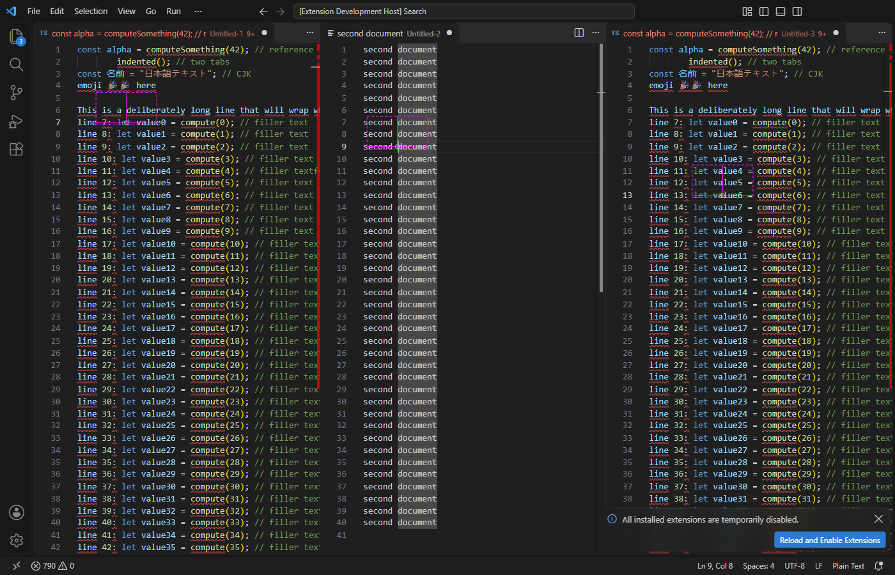

#### Chromium shares one animation timeline per image URL

A second image with an identical data URI, added 1.5 s after the first, showed the first image's progress (0.65 instead of 0.25 for a unique URI). A URI that is shown again after being removed displays the **frozen end state**, even after 3 s off-screen. So:

- **every burst must have a unique SVG** (KeyBlaze must add a nonce, not rely on random seeds alone);
- a "fixed pool of pre-rendered images" can't be used for one-shot animations.

### Q6. Performance of continuous animations

The test used real keystrokes in a plaintext document with KeyBlaze engine bursts. Latency is measured from keydown to the first animation frame in which VS Code moved the caret, using a non-blocking probe inside the page. The table shows only the clean run, [`results6.json`](spike/data/results6.json). Earlier runs were distorted by blocking probes and by the TypeScript language service saturating the renderer, as explained below.

| Configuration                                                | Typing | Key→caret p50 / p95 (ms) | Frames > 50 ms | Renderer busy |
| ------------------------------------------------------------ | ------ | ------------------------ | -------------- | ------------- |
| Effects OFF                                                  | 12/s   | 10.3 / 14.7              | 0              | 23%           |
| Current defaults (≤24 bursts/s, pool 16, 14 particles, high) | 12/s   | 10.5 / 20.7              | 0              | 62%           |
| Capped (≤12 bursts/s, pool 8)                                | 12/s   | 10.1 / 15.1              | 0              | 62%           |
| Performance mode (capped)                                    | 12/s   | 10.3 / 16.3              | 0              | 59%           |
| Worst case (60 particles, ≤24/s)                             | 12/s   | 24.1 / 40.8              | 2              | 91%           |
| Effects OFF                                                  | 25/s   | 10.6 / 15.2              | 0              | 39%           |
| Current defaults                                             | 25/s   | 14.1 / 24.9              | 0              | **99%** ⚠️    |
| Capped (≤12 bursts/s, pool 8)                                | 25/s   | 10.4 / 17.9              | 0              | 89%           |
| Performance mode (capped)                                    | 25/s   | 9.9 / 13.4               | 0              | 81%           |
| Worst case (60 particles)                                    | 25/s   | **123.7 / 178.3** ❌     | 24             | 104%          |

Where the cost goes, measured in isolation ([`results7.json`](spike/data/results7.json)):

- **Extension host:** 0.1–1 ms per burst (simulation, SVG and base64). Negligible.
- **Renderer style recalculation:** about **4.5 ms per burst**. Each unique image adds a CSS rule, and the workbench has about 12,500 rules. A fixed-image type would cost 0.8 ms, but it isn't usable (see the shared-timeline finding).
- **Renderer rasterisation:** about **50 ms of renderer time per burst** over its 650 ms life. Chromium re-rasterises the animated SVG every frame. This scales with display refresh rate (144 Hz here), image area, element count, glow and lifetime.
- **No leak:** after 550 bursts, CSS rule and DOM node counts were unchanged. VS Code removes decoration rules and the heap is reclaimed. Idle load returned to baseline (6–14%).

**Caveat (environment, not KeyBlaze):** with language features active, typing very long nonsense identifiers in a TypeScript file made the TS language service saturate the renderer. That slowed typing to 17 keystrokes/sec achieved **with effects off**. Effects added on top of that made it worse ([`results5.json`](spike/data/results5.json)). KeyBlaze must therefore stay well under the renderer budget, because the user's other extensions share it.

### Q7. Limitations of the official API

1. **No caret pixel coordinates, no font metrics, no editor geometry.** Everything has to be expressed relative to text positions.
2. **No overlay layer.** Effects can only be drawn inside the text through decoration attachments, and webviews can't overlay editors.
3. **Decoration images extend upward from the baseline only.** Full-circle effects need the below-anchor technique.
4. **No vertical-align, position or transform** on attachments. Only `margin`, `width`, `height`, colours and borders are available. Using `textDecoration` for anything else would be CSS injection.
5. **Animation timeline per image URL.** Every burst needs a unique SVG, and every burst inserts a CSS rule (about 4.5 ms of style recalculation each).
6. **Editor font zoom isn't observable**, so line height can't be known exactly when it's used.
7. **Word-wrap row positions, folding and inlay-hint widths aren't exposed** as geometry. Folds and inlay hints can be partly inferred (`visibleRanges`, `vscode.executeInlayHintProvider`). Wrap rows can't.
8. **Screen shake of the text isn't possible** without moving editor text. This confirms the approved Impact Pulse alternative.
9. **Sound:** the extension host has no audio. Sound has to play in a webview (it was not part of this spike's scope; round-trip messaging is fast enough).

## 3. Recommended architecture for Phase 4

1. **Fix first:** replace `attachmentMargin()` with the zero-height model (`margin-top = −H`, horizontal `−W/2`). Add a nonce to every burst SVG.
2. **Hybrid anchoring, chosen per keystroke:**
   - **Below-anchored, full circle** by default, with the SVG origin padded onto the caret line.
   - Automatic **fallback to caret-anchored**, with an upward variant of the effect, when below-anchoring is unreliable:
     - a non-ASCII-width character before the caret on the caret line (CJK, emoji and so on);
     - `editor.wordWrap` is on and the caret line or the lines below could wrap;
     - the anchor line isn't contiguous in `visibleRanges` (a fold);
     - inlay hints come before the caret on the caret line;
     - fewer than _N_ lines below the caret (end of document).
   - Every effect gets both a **full** variant and an **upward** variant. The engine already supports this through spawn angles and gravity. Fire, stars and sparks are naturally upward.
3. **Keep the renderer pipeline:** ParticleEngine → BurstTrack → SvgRenderer → decoration slot pool. The spike validated the slot pool, the animation continuity and the absence of leaks.
4. **Renderer budget (new defaults, based on the measurements above):**
   - `maxBurstsPerSecond` **12** (was 24);
   - `maxConcurrentBursts` **8** (was 16);
   - `particleCount` maximum **40** (was 100);
   - glow only at **high** quality;
   - default lifetime ≤ 700 ms;
   - image half-extent ≤ 120 px;
   - when the typing rate exceeds about 15 keystrokes/sec, render every second keystroke (combos still count every keystroke).

   Performance mode stays as measured.

5. **Webviews for the Control Panel preview** (Canvas renderer using the same BurstTrack) and for **sound**. Never for editor effects.
6. **Turn the harness into a visual regression suite (Phase 8):** CDP-measured dx, dy and text shift for each anchor and each case, plus the animation-continuity and performance checks. The spike proved these catch bugs that API-level tests miss.

## 4. Files

| Path                                               | Purpose                                                                                  |
| -------------------------------------------------- | ---------------------------------------------------------------------------------------- |
| `spike/poc/package.json`, `spike/poc/extension.js` | PoC extension (official APIs only)                                                       |
| `spike/lib.mjs`                                    | Harness: launch, CDP helpers, measurement, pixel analysis                                |
| `spike/run.mjs`                                    | Q1–Q5 scenarios: cursor API, precision, typing, continuity, split, scroll, zoom, webview |
| `spike/run2.mjs`                                   | Continuity with unique URIs, shared-timeline test, scroll continuity                     |
| `spike/run3.mjs`, `spike/run6.mjs`                 | Performance matrix (TypeScript doc / plaintext doc)                                      |
| `spike/run4.mjs`, `spike/run5.mjs`                 | Leak and long-line diagnostics                                                           |
| `spike/run7.mjs`                                   | Image-URL replay and per-burst style cost                                                |
| `spike/evidence.mjs`, `spike/demo.mjs`             | Evidence screenshots and filmstrip                                                       |
| `spike/README.md`                                  | How to re-run                                                                            |
| `docs/spike/img/*.png`, `docs/spike/data/*.json`   | Screenshots and raw results                                                              |
| `.gitignore`                                       | Ignores `spike/results/` (profiles and raw output)                                       |

**No file under `src/` or `test/` was changed.** The existing 131 unit and 22 integration tests still pass (re-run after the spike).
